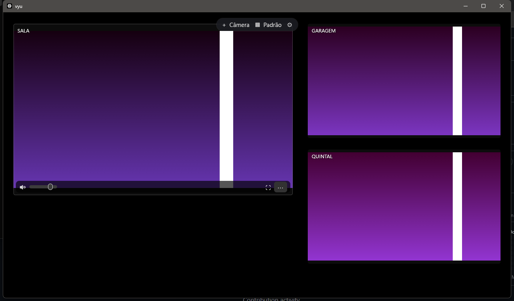
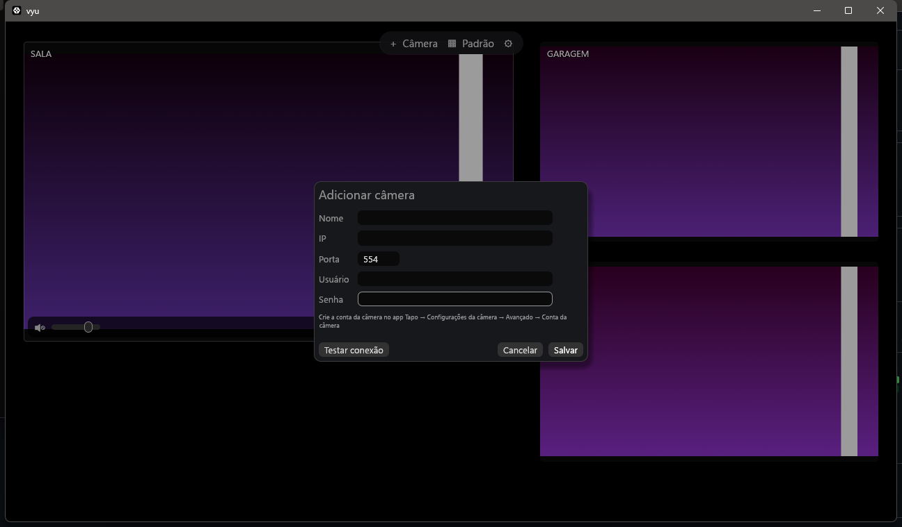

# vyu

**Suas câmeras, sempre à vista.** Visualizador leve para câmeras **Tapo** (e qualquer câmera **RTSP**) no Windows, feito para ficar aberto como um monitor fixo.

Chega de abrir dois VLC e digitar endereço e senha toda vez: você cadastra cada câmera uma única vez, organiza os vídeos do jeito que quiser e, quando abrir o vyu de novo, está tudo exatamente como você deixou.



## O que ele faz

- **Tela livre**: arraste, redimensione e sobreponha os vídeos onde quiser. Eles se alinham sozinhos às bordas vizinhas.
- **Áudio por câmera**: cada câmera tem botão de mudo e volume próprios. Pode ouvir várias ao mesmo tempo.
- **Layouts salvos**: monte arranjos como "Dia" e "Noite" e troque com `Ctrl+1…9`.
- **Qualidade automática**: blocos pequenos usam o stream leve (`stream2`), blocos grandes usam o de alta qualidade (`stream1`). Economiza Wi-Fi e processador sem você pensar nisso.
- **Reconexão automática**: se a câmera ou o Wi-Fi cair, o vyu tenta de novo sozinho (1, 2, 4… até 30 s).
- **Senhas seguras**: ficam no Gerenciador de Credenciais do Windows, nunca em arquivo de texto.
- **Leve**: escrito em Rust, com decodificação de vídeo pela placa de vídeo (D3D11) quando disponível.

## Primeiros passos

### 1. Crie a "conta da câmera" no app Tapo

As câmeras Tapo só liberam o vídeo para outros programas depois que você cria uma conta específica:

1. Abra o app **Tapo** no celular e toque na câmera.
2. Vá em **Configurações (⚙) → Avançado → Conta da câmera**.
3. Crie um **usuário** e uma **senha**. Não é o seu login da Tapo.
4. Em **Configurações → Informações do dispositivo**, anote o **endereço IP** (ex.: `192.168.0.20`).

> Dica: no seu roteador, reserve um IP fixo para cada câmera. Assim o endereço não muda.

### 2. Adicione a câmera no vyu

Abra o vyu e clique em **Adicionar primeira câmera** (ou `+ Câmera` na barra do topo, ou `Ctrl+N`). Preencha nome, IP, usuário e senha, clique em **Testar conexão** para ver uma prévia e depois em **Salvar**.



### 3. Organize

| Quero… | Como |
|---|---|
| Mover um vídeo | Clique e arraste |
| Mudar o tamanho | Arraste uma borda ou canto (`Shift` mantém 16:9) |
| Mover sem "grudar" nos outros | Segure `Alt` enquanto arrasta |
| Ver uma câmera na janela toda | Duplo clique (ou ⛶). `Esc` ou duplo clique para voltar |
| Ligar o som | Passe o mouse no vídeo → 🔇/🔊 e volume. Ou tecla `M` |
| Qualidade / preencher o bloco | Menu `⋯` do vídeo |
| Salvar e trocar layouts | `▦` na barra do topo, ou `Ctrl+1…9` |
| Escolher quais câmeras aparecem num layout | `▦` → caixas "Câmeras em …" |
| Tela cheia | `F11` |
| Abrir junto com o Windows | `⚙` → Iniciar com o Windows |

A barra do topo some depois de 2 segundos sem mexer o mouse, para deixar só os vídeos.

## Experimente sem câmera (modo demonstração)

Para ver o app funcionando antes de configurar as câmeras, rode com a variável `VYU_DEMO=1`. Ele cria três câmeras simuladas, com imagem animada e um tom de áudio. O modo demo usa um arquivo de configuração separado e não mexe nas suas câmeras reais.

```powershell
$env:VYU_DEMO = "1"; .\vyu.exe
```

## Onde ficam os dados

| O quê | Onde |
|---|---|
| Câmeras, layouts, preferências | `%APPDATA%\vyu\config.json` |
| Senhas | Gerenciador de Credenciais do Windows → *Credenciais do Windows* → `vyu` |
| Logs (para diagnóstico) | `%APPDATA%\vyu\logs\` |

Se o `config.json` for corrompido, o vyu guarda uma cópia (`config.json.bak-…`) e começa do zero, sem travar.

## Problemas comuns

| Mensagem no vídeo | O que fazer |
|---|---|
| *Usuário ou senha incorretos* | Confira a **conta da câmera** no app Tapo (não é o login Tapo) e use **Editar câmera** |
| *Câmera não encontrada em 192.168…* | Verifique o IP no app Tapo e se o PC está na mesma rede. O vyu continua tentando sozinho |
| *A câmera parou de enviar vídeo* | Geralmente Wi-Fi fraco. O vyu reconecta automaticamente |
| *Senha não encontrada* | A senha foi apagada do Gerenciador de Credenciais. Use **Editar câmera** e digite de novo |

Para diagnosticar uma câmera pelo terminal (com o código-fonte):

```powershell
cargo run --example probe -- 192.168.0.20 usuario senha low
```

## Compilar a partir do código

Pré-requisitos (uma vez só):

1. [Rust](https://rustup.rs) (toolchain `stable-x86_64-pc-windows-msvc`) com o Visual Studio Build Tools.
2. `libclang`, usado para gerar os bindings do FFmpeg. O jeito mais simples:
   ```powershell
   python -m pip install --user libclang
   ```
   (ou instale o LLVM e defina `LIBCLANG_PATH` para a pasta `bin` dele).
3. As bibliotecas do FFmpeg (baixadas para `vendor/ffmpeg`):
   ```powershell
   powershell -ExecutionPolicy Bypass -File scripts/setup-ffmpeg.ps1
   ```
   O script mostra os comandos para definir `LIBCLANG_PATH` e o `PATH`.

Depois:

```powershell
$env:LIBCLANG_PATH = "<pasta do libclang mostrada pelo script>"
$env:PATH = "$PWD\vendor\ffmpeg\bin;" + $env:PATH
cargo run            # abre o app
cargo test           # roda os testes
```

Para gerar o pacote de distribuição (`dist\vyu-windows-x64.zip`, com o `.exe` e as DLLs):

```powershell
powershell -ExecutionPolicy Bypass -File scripts/package.ps1
```

## Documentação

- [Arquitetura](docs/architecture.md): como o código está organizado e como os dados fluem.
- [Testes](docs/testing.md): testes automáticos e roteiro de teste com câmeras reais.
- [Design](docs/superpowers/specs/2026-11-02-vyu-design.md) e [plano de implementação](docs/superpowers/plans/2026-11-02-vyu.md).

## Próximos passos (roadmap)

- Busca automática das câmeras na rede (ONVIF)
- Controle de movimento (PTZ) para câmeras com motor
- Foto instantânea e gravação
- Janela "sempre no topo"

## Licença

[MIT](LICENSE). O FFmpeg é distribuído sob LGPL, com link dinâmico; veja [THIRD_PARTY.md](THIRD_PARTY.md).
