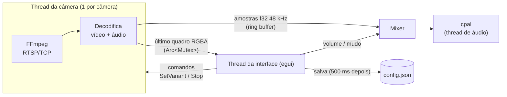
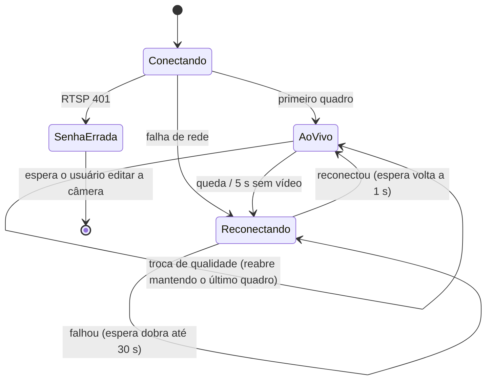

# Arquitetura do vyu

Um único programa Rust. As partes com lógica, como geometria, sessões, mixer e configuração, não dependem de interface nem de hardware, e por isso têm testes automáticos. As partes que conversam com o mundo externo (FFmpeg, placa de som, cofre de senhas do sistema, início automático) são adaptadores finos.

## Mapa dos módulos

```
src/
├─ main.rs            Entrada: logs + abre a janela (eframe)
├─ lib.rs             Declara os módulos
├─ app/               Interface (egui)
│  ├─ mod.rs          VyuApp: estado geral, atalhos, estado vazio, salvamento
│  ├─ tiles.rs        Desenha os vídeos, arrastar/redimensionar, controles ao passar o mouse
│  ├─ runtime.rs      Liga/desliga a sessão de cada câmera conforme o layout ativo
│  ├─ bar.rs          Barra flutuante (+ Câmera · Layouts · ⚙) que some sozinha
│  ├─ dialogs.rs      Janelas de câmera, layouts e configurações
│  └─ style.rs        Fontes do sistema (Segoe UI / Ubuntu, Noto, DejaVu) + tema escuro
├─ canvas/            Geometria pura da tela livre (sem egui)
│  ├─ geometry.rs     Rect, alças de borda/canto, arrastar, tamanho mínimo, 16:9, z-order
│  └─ snap.rs         Linhas-guia: "grudar" em bordas vizinhas e da janela
├─ stream/            Vídeo e áudio das câmeras
│  ├─ url.rs          Monta a URL RTSP (com escape) e mascara a senha para logs
│  ├─ session.rs      Uma thread por câmera: estados, reconexão, troca de qualidade
│  ├─ backoff.rs      Esperas de reconexão: 1, 2, 4, 8, 16, 30 s
│  ├─ quality.rs      Escolha automática stream1/stream2 com histerese
│  ├─ ffmpeg.rs       Fonte real: RTSP → H.264/H.265 → RGBA; G.711 → 48 kHz
│  ├─ demo.rs         Fonte simulada para VYU_DEMO=1
│  └─ frame.rs        Quadro RGBA + "último quadro" compartilhado
├─ audio/
│  ├─ mixer.rs        Soma o áudio das câmeras com volume/mudo individual
│  └─ output.rs       Toca o mix na saída padrão (cpal/WASAPI)
├─ config/
│  ├─ model.rs        Camera, Tile, Layout, Settings, Config (+ operações de layout)
│  └─ store.rs        Leitura/gravação atômica do config.json, backup se corrompido
├─ secrets.rs         Senhas no cofre do sistema: Credential Manager / Secret Service (crate keyring)
├─ autostart/         "Iniciar com o sistema": windows.rs (HKCU\…\Run), linux.rs (~/.config/autostart)
└─ logging.rs         Logs diários em %APPDATA%\vyu\logs (Linux: ~/.config/vyu/logs)
```

## Threads e fluxo de dados



- **Vídeo:** a sessão guarda só o **último quadro**. A interface o envia para a GPU quando o número de sequência muda. Se a interface atrasar, quadros antigos são descartados em vez de acumular, então o vídeo nunca fica "atrasado".
- **Áudio:** cada câmera escreve num ring buffer próprio, com até 0,5 s. O mixer mantém no máximo 250 ms na fila para o som ficar perto do ao vivo, aplica o volume (0 se mudo), soma e limita a [-1, 1].
- **Qualidade:** a cada quadro, a interface mede a altura do bloco em pixels físicos. Acima de 540 px pede `stream1`; abaixo de 400 px volta para `stream2`. A troca só acontece depois de 1 s estável.
- **Câmeras ativas:** só as câmeras que aparecem no layout ativo ficam conectadas. Trocar de layout liga e desliga as sessões.

## Estados de cada câmera



| Situação | O que aparece no vídeo |
|---|---|
| Conectando | "Conectando…" |
| Queda / sem vídeo por 5 s | Último quadro escurecido + motivo + "Reconectando (tentativa N, a cada X s)…" |
| Senha errada | "Usuário ou senha incorretos" + botão **Editar câmera** (não tenta de novo sozinho) |
| Senha ausente no cofre do sistema | "Senha não encontrada" + **Editar câmera** |
| Sem placa de som | App funciona sem áudio; aviso no topo |
| config.json corrompido | Backup `config.json.bak-<data>`, começa do zero, aviso no topo |

## Decisões importantes

- **FFmpeg com link dinâmico (LGPL):** suporta H.264/H.265, aceleração por GPU (D3D11 no Windows; CUDA/VA-API no Linux) e o áudio G.711 das Tapo. No Windows as DLLs acompanham o `.exe`; no Linux usa o FFmpeg da distribuição.
- **`fflags=nobuffer` não é usado:** essa opção descarta os pacotes lidos durante a análise inicial, incluindo o primeiro quadro-chave, e a câmera demoraria a mostrar a primeira imagem.
- **Fechar uma câmera não trava a interface:** uma leitura do FFmpeg pode bloquear até 5 s; a interface espera no máximo 300 ms e deixa a thread terminar sozinha.
- **Posições normalizadas (0–1):** o layout acompanha qualquer tamanho de janela ou monitor, e os blocos nunca ficam fora da tela.
